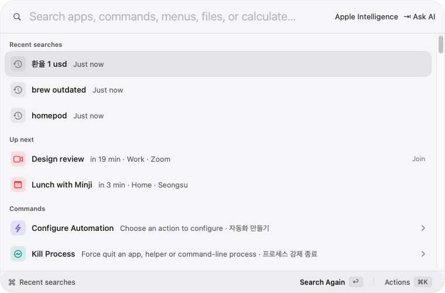
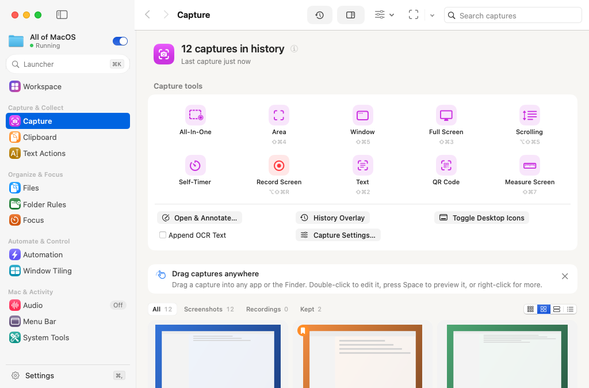
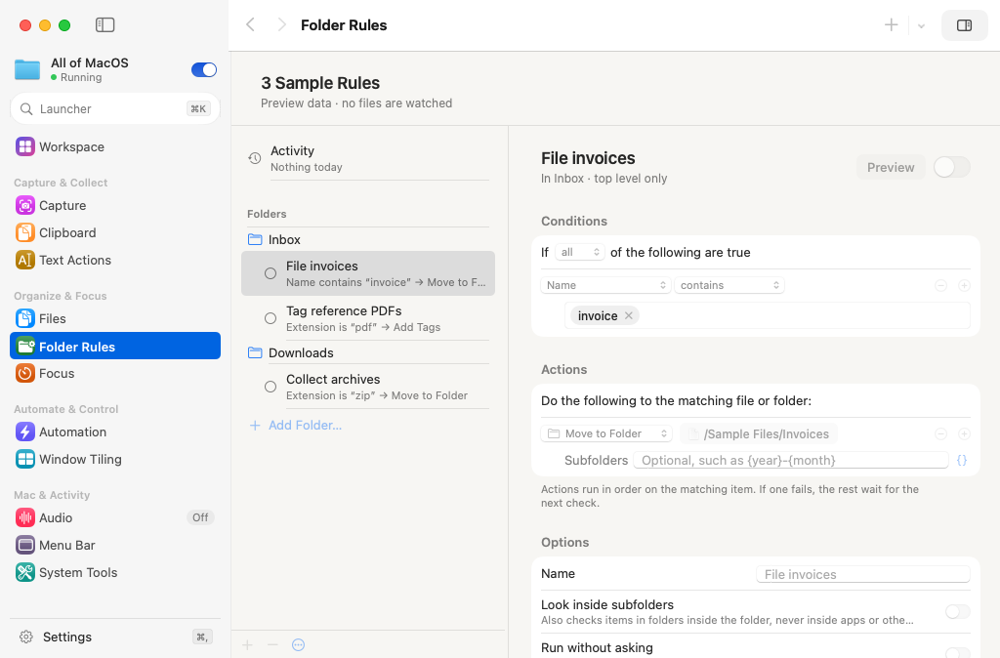
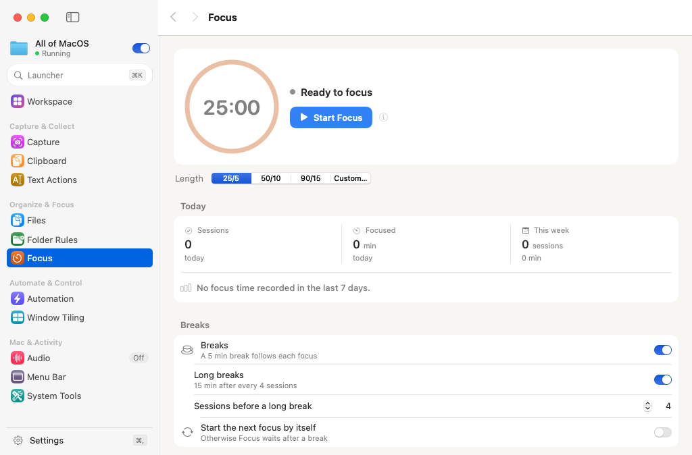

# All of MacOS (AOM)

**All of MacOS** is a native macOS productivity suite built with SwiftUI and AppKit for macOS 14 and later. It brings input automation, window management, screen capture & annotation, encrypted clipboard history, a floating command launcher with local/API AI queries, file organization, focus timers, per-app audio control, menu bar management, and system utilities together into one cohesive desktop workbench.

[](https://github.com/kyw1-2/All-of-MacOS/releases)


---

## Core Features

### 1. Automation & Window Management
- **Multi-Input Automation**: Trigger actions from Trackpad gestures, Keyboard shortcuts & key sequences, Mouse buttons (buttons 3–32 & side thumb-wheel), Drawing gestures, MIDI/Force Touch pressure, and system events. Build branching workflows with `If / Else`, `Wait`, variables (`{{var:name}}`), Hyper Key (`⌃⌥⇧⌘`), key remapping, and `.bttpreset` trigger import.
- **Title-Bar Trackpad Window Snapping & Tiling**: Snap, maximize, center, minimize, close/quit, or fullscreen windows with two-finger gestures directly on window title bars (`2×2`, `3×2`, `3×3` grids), Drag-to-Snap screen zones, per-display layout profiles, Saved Windows restore previews, **Scenes** (launch apps → arrange windows → set audio/Focus), live keep-on-top **Window Pinning**, and a thumbnail **Window Switcher** (`⌃⇥`).

| Automation (`Steps \| Recipe`) | Window Tiling & Scenes |
| :---: | :---: |
|  |  |

### 2. Command Launcher (`⌥Space` / `⌘K`) & Ask AI
- **Non-Activating Floating Panel**: Launch apps, search Spotlight files, browse folders, run system & Homebrew commands, view open browser tabs, expand dynamic snippets, convert units/math, kill/uninstall apps with `~/Library` cleanup, check upcoming calendar availability, and configure shortcuts — without stealing focus from the frontmost app.
- **Ask AI (`⇥`)**: Stream answers using on-device Apple Intelligence, configured remote API endpoints, local LLM servers, or CLI agents, with explicit per-question context scoping (`@window`, `@screen`, `@clip`, `@wiki`, `@files`, `@~/path`, `@shell`, `@ssh`).

| Floating Launcher (`⌥Space` / `⌘K`) | Menu Bar Control Panel |
| :---: | :---: |
|  |  |

### 3. Screen Capture, Clipboard & Text Actions
- **Capture, Recording & Annotation**: Area (`⇧⌘4`), Window (`⇧⌘5`), Full Screen (`⇧⌘3`), Scrolling Capture (`⌥⇧⌘S`), Self-Timer, OCR Text Capture (`⇧⌘2`), QR recognition, **Screen Ruler (`⇧⌘7`)**, and MP4/GIF Screen Recording (with custom canvas backgrounds, click animations, cursor highlight, keystroke overlay, camera bubble, and trimming). Includes a Quick Access hover curtain and full annotation editor.
- **Encrypted Clipboard History (`⇧⌘V`)**: Local Keychain-backed clipboard history with pinboards, image OCR indexing, region-selection OCR, plain-text/HTML/RTFD pasting, side-by-side text diff (**Compare With…**), secret detection, and structured search queries.
- **Text Actions & Click Hints (`⇧⌘Space`)**: Contextual action bar over selected text (copy, search, translate, look up, calculate, pin, custom AI prompts) and keyboard-driven UI click labels.

| Capture Studio | Clipboard Library & Inspector |
| :---: | :---: |
|  |  |

### 4. Files, Folder Rules & Focus
- **Files & Drop Shelf**: Quick-jump folder sidebar beside macOS Open and Save panels (`⌘⌥1–⌘⌥9` for favorites), pointer-shake **Drop Shelf** with multiple named shelves, and local file utilities (**Compare PDFs**, **Compare Folders**, **Extract from ZIP**, **Storage Map**, **Batch Rename**, image/video/PDF conversion).
- **Folder Rules**: Watch Downloads, Desktop, or custom directories with safe dry-run previews, `{year}-{month}` subfolder templates, image optimization, automatic `.dmg` installation, and local scanned-PDF OCR inspection.
- **Focus**: Customizable focus/break intervals (`25/5`, `50/10`, `90/15`), menu bar countdown, session metrics, distracting-app hiding, and optional idle-app cleanup.

### 5. Menu Bar, Audio & System Tools
- **Menu Bar Management**: Arrange status icons into **Shown**, **Hidden**, and **Always Hidden** lanes with saved **Presets**, open a collapsible secondary Bar strip, customize AOM's own menu/panel, and display live city-based Menu Bar Weather (`°C`/`°F`).
- **Per-App Audio & Battery / Hardware**: Core Audio per-app volume (`0–400%` Overdrive), per-app Mute & Stereo Balance, 10-band Headphone EQ with AutoEQ import, Audio Unit v2 effect hosting, and HomePod/AirPlay stream continuity diagnostics; macOS native Charge Limit (`80–100%`), Hold Here, Discharge/Top Up controls, DDC/CI external monitor controls, and System Tools quick toggles.

| Folder Rules | Menu Bar Layout | System Tools |
| :---: | :---: | :---: |
|  |  |  |

---

## Usage Examples

### Launcher Search & Calculator (`⌥Space` or `⌘K`)
- **Arithmetic & Units**:
  - `12 * 11` → `132`
  - `20% of 150` → `30`
  - `10 km in mi` → `6.21371 mi`
  - `255 in hex` → `0xFF`
- **File Search & Folder Navigation**:
  - Search inside a folder by type and recency: `in:~/Documents kind:pdf modified:7d invoice`
  - Search emoji by keyword: `:fire` or `:check` (press `↩` to type into the active app)

### Clipboard Filter Operators (`⇧⌘V` or Clipboard Search)
```text
type:image from:Safari board:"Project Notes" is:pinned after:7d -draft
```
- Supported filters: `type:text|link|image|file|color`, `from:<App>`, `board:<Name>` / `pinboard:<Name>`, `is:pinned` / `is:unpinned`, `before:` / `after:` / `on:` (`yyyy-MM-dd`, `today`, `yesterday`, `7d`, `2w`, `3m`, `1y`), `"exact phrase"`, `-exclude`.

### Ask AI Context Scopes (`⇥` in Launcher)
```text
@window summarize these error logs
@screen explain what is selected here
@files ~/Projects/notes find references to release signing
```
- Available explicit attachments: `@window` (front window OCR), `@screen` (active display OCR), `@clip` (clipboard text), `@wiki`, `@chats`, `@shell`, `@ssh` (non-secret SSH host config only), `@files` / `@~/path`.

### Dynamic Snippets & Folder Rules Tokens
- **Interactive Snippet Template**:
  ```text
  Hello{arg:recipient},

  Shipping method: {choice:Delivery|Courier|*Visit}
  Date: {date:yyyy-MM-dd}

  {optional:Signature}Best regards,
  {clipboard}{/optional}{cursor}
  ```
- **Folder Rules Path & Rename Pattern**:
  - Subfolder template: `{year}-{month}` → e.g. `2026-11/Invoices`
  - Rename template: `{name} {date:yyyy-MM-dd}` (or `{pdfdate}` / `{after:Vendor}` on scanned/text PDFs)
- **Batch Rename Pattern**:
  - `{date} {name} {nn}` with full collision preview and inode-checked Undo.

### Title-Bar Trackpad Window Gestures
Hover two fingers over any window title bar:

| Gesture | Action |
| --- | --- |
| Swipe `←` / `→` | Snap Left Half / Right Half (continue for Thirds) |
| Swipe `↑` | Maximize (`⇧` for Almost Maximize; `↑` twice for Top Half) |
| Swipe `←↑` / `→↑` (L-shape) | Snap Top-Left / Top-Right Quarter |
| Swipe `↓` | Unsnap to prior frame / Minimize free window |
| Pinch In / Out | Close window (Pinch In twice to Quit) / Toggle Full Screen |
| Hold still `2 s` | Cancel gesture before lifting |

### URL Automation (`aom://`)
```bash
open "aom://capture-area"
open "aom://record-screen"
open "aom://show-keystrokes?mode=shortcuts"
open "aom://trigger?name=Tidy%20the%20front%20window"
```
External `aom://trigger` links prompt for explicit confirmation (`Run Once` / `Always Allow` / `Don't Run`).

---

## Default Keyboard Shortcuts

| Feature | Shortcut | Feature | Shortcut |
| --- | --- | --- | --- |
| Global Launcher | `⌥Space` (`⌘K` in app) | Capture Area | `⇧⌘4` |
| Clipboard History Shelf | `⇧⌘V` | Capture Window | `⇧⌘5` |
| Thumbnail Window Switcher | `⌃⇥` | Capture Full Screen | `⇧⌘3` |
| Screen Ruler (Measure) | `⇧⌘7` | Capture Text (OCR) | `⇧⌘2` |
| Click Hints | `⇧⌘Space` | Scrolling Capture | `⌥⇧⌘S` |
| Capture History | `⇧⌘6` | Record Screen | `⌥⇧⌘R` |
| Pin Last Capture | `⌥⇧⌘P` | Toggle Desktop Icons | `⌥⇧⌘D` |

---

## Identity, Build & Distribution

- **App Identifier**: `com.kyw.allofmacos` · **Helper**: `com.kyw.allofmacos.ScriptRunner`
- **Build & Self-Sign (macOS with Xcode)**:
  ```bash
  brew list webp >/dev/null 2>&1 || brew install webp
  ALLOFMACOS_SCRATCH_PATH="$HOME/.cache/aom-build" ALLOFMACOS_SKIP_AUTO_RELEASE=1 ./build-and-sign.sh
  codesign --verify --deep --strict "build/All of MacOS.app"
  ```
- **Run Tests (SwiftPM)**:
  ```bash
  scripts/run-tests.sh -j 2
  ```
- **Distribution**: Prebuilt DMGs are published on [GitHub Releases](https://github.com/kyw1-2/All-of-MacOS/releases) signed with the self-signed **AOM Dev** certificate (not Apple Developer ID notarized; Gatekeeper may request manual approval on first launch). Version-by-version history is maintained in [CHANGELOG.md](CHANGELOG.md).
