# All of MacOS (AOM)

**All of MacOS** is a native macOS productivity suite built with SwiftUI and AppKit for macOS 14 and later. It unifies multi-input automation, window management, screen capture & recording studio, annotation, encrypted clipboard history, contextual text actions, file organization & folder rules, focus sessions, per-app audio & equalizer control, menu bar management, a floating command & AI launcher, MCP integration, and 40+ system utilities into one native workbench.

[](https://github.com/kyw1-2/All-of-MacOS/releases)


[](LICENSE)

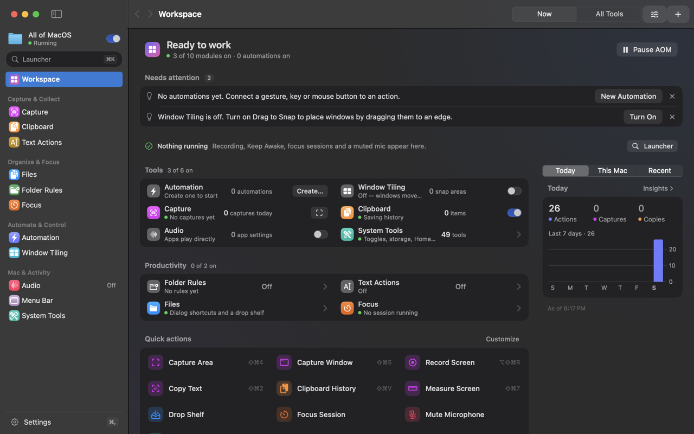

---

## Feature Map

| Module | What It Does | Shortcut / Entry |
| --- | --- | --- |
| **Workspace** | Unified status, attention cards, customizable quick actions, live sessions | `⌘1` |
| **Command Launcher & Ask AI** | Search apps/files/tabs/symbols/math/snippets & query local/API/CLI AI | `⌥Space` / `⌘K` (`⇥` for AI) |
| **Menu Bar Pocket Panel** | Search, Focus/Keep Awake chips, Sound strip, 4 feature tiles, recent pastes | Click Menu Bar Icon |
| **Quick Entry** | Non-activating floating capture for Notes, Reminders & natural-language events | `⌃⌥N` |
| **Automation & Workflows** | Trackpad, keyboard, mouse, drawing, MIDI, watchers, UI/image actions, scripts | `⌘2` |
| **Window Tiling & Scenes** | Title-bar gestures, Drag-to-Snap zones, starter sets, pinning, switcher, Scenes | `⌘3` / `⌃⇥` |
| **Capture, Studio & Meetings** | Screenshots, scrolling, OCR, ruler, MP4/GIF studio, annotation, meeting notes | `⌘4` / `⇧⌘3–7` |
| **Clipboard History** | AES-GCM encrypted history, pinboards, secrets masking, `~` semantic search, diff | `⌘5` / `⇧⌘V` |
| **Audio & Headphone EQ** | Per-app volume (`0–400%`), balance, 10-band EQ + AutoEQ, AUv2, HomePod health | `⌘6` |
| **System Tools** | Toggles, DDC display, Battery limit, Uninstaller, Storage Map, Network, Brew, VPN | `⌘7` |
| **Activity & Telemetry** | Trigger counts, hit/recognition rates, time-bucket charts, filtered event logs | `⌘8` |
| **Folder Rules** | Watch folders with Dry-Run previews, `{year}-{month}`, PDF OCR, auto-`.dmg` install | `⌘9` |
| **Text Actions & Click Hints** | Selection toolbar, Korean/English layout conversion, keyboard click labels | Sidebar / `⇧⌘Space` |
| **Files & Drop Shelf** | Open/Save sidebar, pointer-shake Drop Shelf, Dual-Pane Browser, PDF/Folder Diff | Sidebar |
| **Focus & Keep Awake** | Pomodoro intervals, distraction app hider, break reminders, Keep Awake timer | Sidebar |
| **Menu Bar Manager** | Shown/Hidden/Always Hidden lanes, collapsible secondary Bar, Weather, AOM Menu | Sidebar |
| **MCP Server & `aom://`** | Unix-socket stdio MCP server (`--mcp`) for clipboard/automation + URL triggers | Settings › AI / Clipboard |

---

## 1. Workspace, Launcher (`⌥Space`), Menu Bar Panel & Quick Entry

- **Workspace (`⌘1`) & App-Wide Appearance**: Shows active module health, permission attention banners, customizable Quick Actions, and favorite sidebar pinning. Supports System, Light, and Dark appearance across the main window and all floating panels, with configurable Translucent Window glass levels (`Subtle`, `Balanced`, `Clear`).
- **Menu Bar Pocket Panel (`396 pt`)**:
  - Immediate live search across AOM commands, hidden menu bar icons (`↩` reveals & opens its menu), and non-secret clipboard entries.
  - One-tap `Focus` and `Keep Awake 1 h` chips (switching cleanly to live session rows with timers/Stop controls when running).
  - Embedded Sound strip (output device picker, Mute toggle, volume slider, App Audio switch), Battery Care row (Limit / Hold Here / Discharge / Top Up), 4 unified feature tiles (`Capture`, `Drag to Snap`, `Clipboard`, `Gesture HUD`) with sliding inline command menus, Recent Copies with destination-aware pasting (`⌥`-click copies), and 4 quick-action buttons.
- **Command Launcher (`⌥Space` / `⌘K`) & Ask AI (`⇥`)**:
  - **Search & Utilities**: Launch apps, Spotlight file search (`in:`, `kind:`, `modified:`), saved searches, folder browsing, browser tabs (Safari, Chrome, Arc, Edge, Brave, Vivaldi), arithmetic/unit/hex/currency calculator (`12 * 11`, `20% of 150`, `10 km in mi`), Emoji & Symbol pickers (`:fire`, `arrow`, `won`), Dynamic Snippets, **Kill Apps / Kill Process**, App Uninstaller, Shortcut Conflict Finder, Calendar availability (**Copy Free Times**), and **13 Launcher Themes** with adjustable opacity and Frosted/Glass material.
  - **Ask AI (`⇥`)**: Streams responses from **Apple Intelligence**, **Anthropic**, **OpenAI**, **DeepSeek**, **Ollama**, **Local Proxy**, **Claude Code CLI**, **Codex CLI**, or **DeepSeek Harness**, with explicit opt-in context attachments (`@window`, `@screen`, `@clip`, `@wiki`, `@chats`, `@shell`, `@ssh`, `@files` / `@~/path`).
- **Quick Entry (`⌃⌥N`)**: Non-activating floating capture box for Notes, Reminders, and Calendar Events that parses Korean and English time expressions (e.g., `"내일 3시 회의"`, `"lunch friday 12pm"`). `⌘↩` saves and keeps the panel ready for the next item without stealing focus.

| Floating Launcher (`⌥Space` / `⌘K`) | Menu Bar Pocket Panel |
| :---: | :---: |
|  | 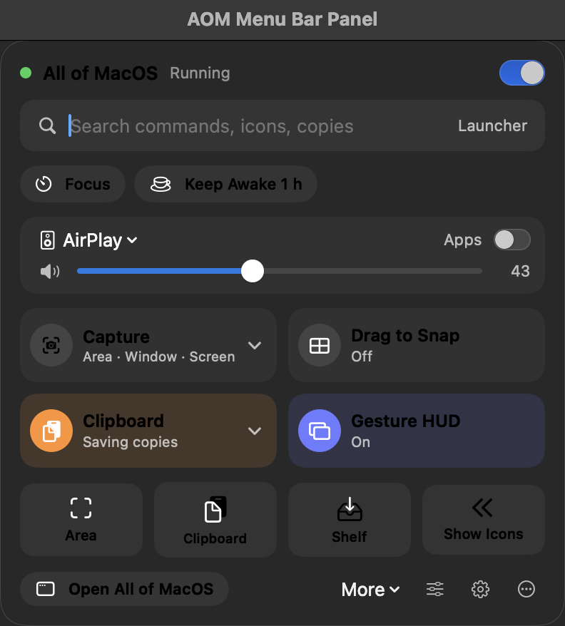 |

---

## 2. Multi-Input Automation & Activity Telemetry (`⌘2`, `⌘8`)

- **Trigger Sources**:
  - **Trackpad**: 1-to-5 finger swipes, taps, pinches, rotations, edge swipes, touch start / long touch holds, release-last-finger, Force Touch, and modifier-held trackpad scrolling.
  - **Keyboard**: Global hotkeys, key sequences, Hyper Key (`⌃⌥⇧⌘`), key remapping, and app/window activation conditions.
  - **Normal Mouse & Devices**: Buttons 3–32 (click, double, triple, long press, 4-direction drag & scroll), pointer-aware **Mouse Back / Forward everywhere** (automatically falls back to each app's native navigation shortcut or AX menu-item cache while typing), Drawing gestures, MIDI, Ulanzi Deck & UGREEN HID device groups, and **`.bttpreset` import**.
  - **Watchers & Custom Triggers**: Microphone on/off, localized on-screen OCR **Text Appears**, system signals, Named Triggers, and customizable **Floating Menus & Widgets**.
- **Action Engine & Scripting**: Over 100 native actions organized into **Steps | Recipe** workflows with drag reordering, `If / Else`, `Wait`, variables (`{{var:name}}`), window/mouse/keystroke synthesis, Accessibility (`AXPress` / value setting), local image template matching, and sandboxed AppleScript / Shell / JXA / Swift execution via the `com.kyw.allofmacos.ScriptRunner` XPC helper.
- **Activity (`⌘8`)**: Tracks total runs, input recognition hit-rate, most-used triggers, `24h` / `7d` / `All Time` charts, configuration totals, and timestamped event logs.

| Automation (`Steps \| Recipe`) | Activity & Analytics |
| :---: | :---: |
| 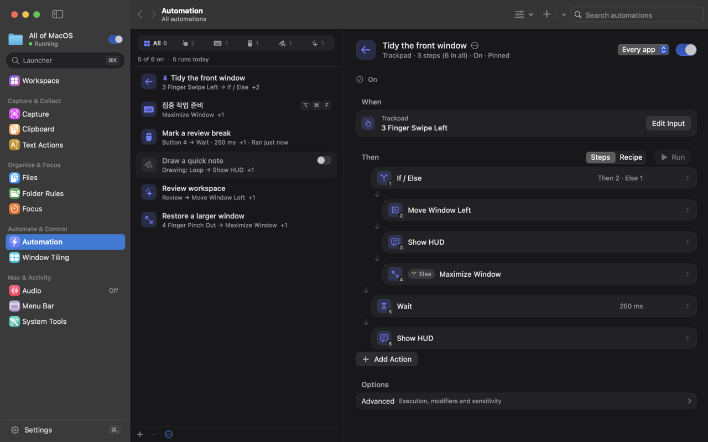 | 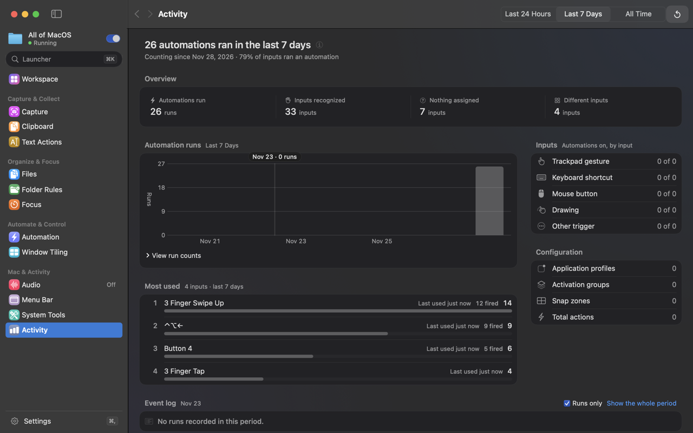 |

---

## 3. Window Tiling, Scenes, Pinning & Window Switcher (`⌘3`)

- **Title-Bar Trackpad Gestures**: Hover two fingers over any window title bar to swipe left/right (halves & thirds), up (maximize / almost-maximize / top half), diagonal L-shapes (quarters), down (unsnap / minimize), or pinch (close / quit / fullscreen).
- **Drag-to-Snap & Zone Profiles**: Drag windows to customizable screen edge zones across multiple displays, start immediately with **Starter Sets** (`Essentials`, `Corners & Halves`, `Complete Set`), switch per-display profiles, or restore **Saved Windows** snapshots with move/skip previews.
- **Scenes, Live Pinning & Window Switcher (`⌃⇥`)**:
  - **Scenes**: Launch or focus groups of apps, restore exact window placements, switch audio/Focus state in one command.
  - **Window Pinning**: Keep live windows Always on Top (`togglePinFrontWindow`, `selectWindowToPin`, `showPinnedWindowPicker`).
  - **Window Switcher (`⌃⇥`)**: Live thumbnail switcher across all open windows.

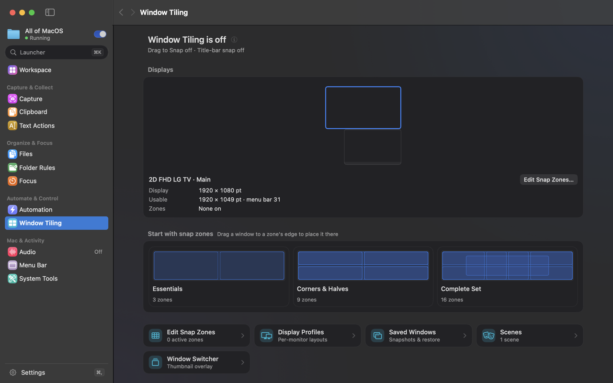

---

## 4. Screen Capture, Recording Studio, Annotation & Meeting Notes (`⌘4`)

- **Capture Modes**: Slim adaptive toolbar for **All-In-One**, **Area** (`⇧⌘4`), **Window** (`⇧⌘5`), **Full Screen** (`⇧⌘3`), **Scrolling Capture** (`⌥⇧⌘S`), **Record Screen** (`⌥⇧⌘R`), plus Self-Timer, **OCR Text Capture (`⇧⌘2`)**, QR recognition, **Screen Ruler (`⇧⌘7`)**, Pin Last Capture (`⌥⇧⌘P`), Toggle Desktop Icons (`⌥⇧⌘D`), and Capture History (`⇧⌘6`) with thumbnail/list views and hover Quick Access curtain.
- **Recording Studio & Export**: Records screen MP4/GIF with 60 Hz pointer tracking, One-Euro cursor smoothing, zoom follow & manual zoom ranges, click rings, keystroke overlay, camera bubble (auto-fading during pauses), custom canvas/backgrounds, and non-destructive pause removal (**Cut Silences**).
- **Bot-Free Meeting Recorder**: Captures microphone + system call audio to `Documents/AOM Meetings/meeting.m4a`, transcribes locally with Me / Others separation, summarizes action items when Apple Intelligence is active, and integrates with menu bar calendar alerts (**Join and Record**).
- **Annotation Editor**: Layered vector editor with arrows, shapes, callouts, numbered steps, blur/pixelate/secure redaction, crop presets, image overlays, plus macOS Preview/Thumbnail/Share extensions.


---

## 5. Encrypted Clipboard (`⇧⌘V`) & Text Actions (`⌘5`)

- **Encrypted Clipboard History (`⇧⌘V`)**:
  - AES-GCM + Keychain encrypted storage in Application Support, colored **Pinboards**, `Paste Stack` (`⇧⌘C`) sequential pasting, and Smart Paste Delivery (relinquishes focus → activates destination → checks `changeCount` → `⌘V`).
  - **Secret Protection & Expiry**: Detects API keys, tokens, private keys, and passwords (hidden behind a lock icon and skipped in free-text search; `⌥`-click or Show reveals temporarily). Items can auto-expire (`1 Hour`, `Tomorrow`, `In a Week`, or `After Pasting Once`).
  - **Search, OCR & Diff**: Full image OCR indexing, **Compare With…** side-by-side text diff, local semantic `~` search, and structured operators (`type:`, `from:`, `board:`, `is:pinned|secret`, `after:|before:|on:`, `"phrase"`, `-exclude`).
- **Text Actions & Click Hints (`⇧⌘Space`)**:
  - Floating selection bar triggered on drag, double/triple-click, or shift-arrow selection: Copy, Cut, Paste, Web/GitHub Search, Open Link, New Email, Look Up, Translate, Calculate, Word Count, Speak, Pin, Custom AI Prompts, and Korean/English layout fix (`dkssud ↔ 안녕`, including optional real-time Space-bar fix outside terminals/editors).
  - **Click Hints (`⇧⌘Space`)**: Displays keyboard labels over clickable macOS UI controls via Accessibility.

| Clipboard History & Inspector | Text Actions & Click Hints |
| :---: | :---: |
| 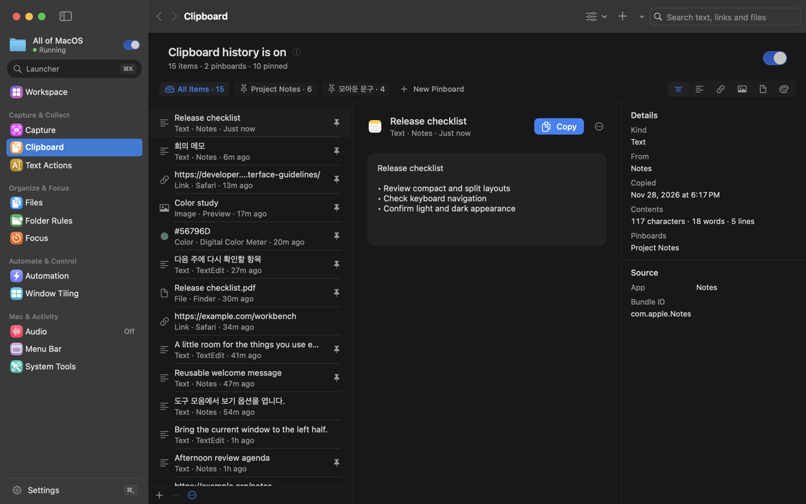 | 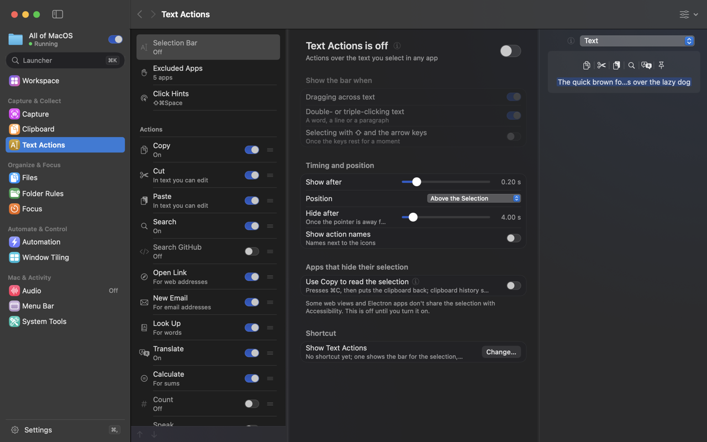 |

---

## 6. Files, Drop Shelf & Folder Rules (`⌘9`)

- **Files Workspace**:
  - **Open/Save Dialog Panel**: Attaches a quick-jump sidebar beside standard macOS file dialogs showing open Finder windows, Favorites (`⌘⌥1–⌘⌥9`), recent folders, and the clipboard path.
  - **Drop Shelf**: Shake the pointer or push dragged files to the screen edge to collect items into multiple named/pinned shelves.
  - **File Utilities**: **Two-Pane File Browser** (drag copy/move with collision handling), **Compare PDFs** (linked scrolling + text parity check), **Compare Folders** (byte-for-byte diff + Copy Missing), **Extract from ZIP** (selective extraction + Quick Look), **Storage Map** (ring chart + size scanner), **Batch Rename** (`{date} {name} {nn}` + undo), and Image/Video/PDF conversion.
- **Folder Rules (`⌘9`)**: Hazel-style directory watchers (Downloads, Desktop, custom folders) with safe **Dry-Run Previews**, iCloud hydration, `{year}-{month}` subfolder templates, rename tokens (`{name}`, `{date:...}`, `{pdfdate}`, `{after:Label}`), on-device scanned PDF OCR, image optimization, and automatic `.dmg` installation.

| Files & Drop Shelf | Folder Rules |
| :---: | :---: |
| 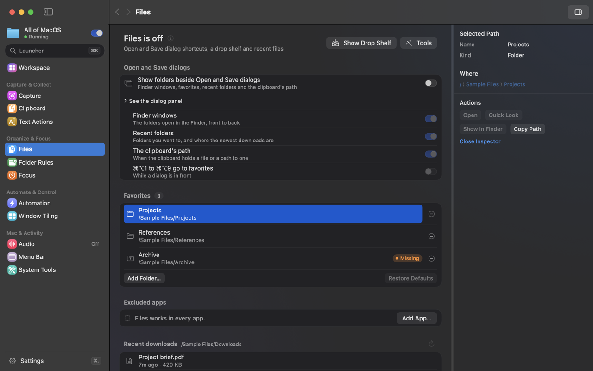 |  |

---

## 7. Focus Sessions & Productivity

- **Focus Workspace**: Configurable focus/break presets (`25/5`, `50/10`, `90/15`, or Custom), monospaced menu bar countdown, automatic distraction-app hiding, sound muting during sessions, Keep Awake lock, eye/stand-up break reminders, start/end automation hooks, and optional idle-app cleanup.

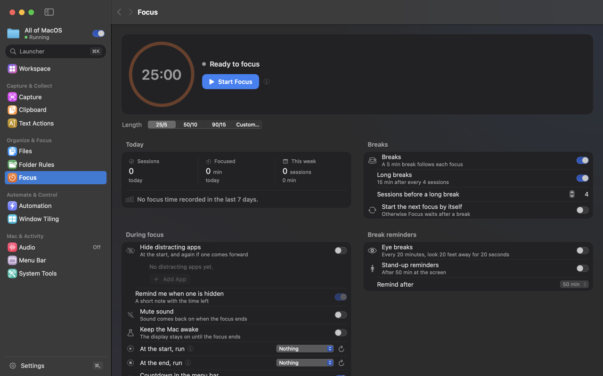

---

## 8. Menu Bar Management, Weather & Per-App Audio (`⌘6`)

- **Menu Bar Manager (`⌘13`)**:
  - **3-Lane Layout Editor**: Drag real status items between **Shown**, **Hidden**, and **Always Hidden** lanes rendered with your calmed menu bar tint (`MenuBarLaneColor`) and **Presets**; lock indicators mark macOS-pinned items (Clock, Control Center).
  - **Secondary Bar Strip & Behavior**: Reveal hidden items in-place or inside a collapsible secondary **Bar** strip under the menu bar, trigger on empty-space click/hover/scroll or per-item hotkeys, customize icon names/symbols, adjust menu bar spacing, and edit AOM's own right-click menu & panel layout.
  - **Menu Bar Weather**: Open-Meteo weather in `°C` / `°F` with multi-city switching, 8-hour & 7-day forecast card, figure-space width stabilization, and optional **Inside AOM's icon** combined view.
- **Per-App Audio (`⌘6`, macOS 14.2+)**:
  - Core Audio process taps with **0–400% Volume Overdrive**, per-app Mute & Stereo Balance, Magic Boost dynamics, **10-band Headphone Equalizer** with **AutoEQ** import, **Audio Unit v2** plugin hosting, and per-app output routing.
  - **HomePod / AirPlay Diagnostics**: Direct AirPlay stream continuity, page residency guard (`AOMAudioWireCode`), **"I Just Heard a Glitch"** 20-second diagnostic capture, and `Check HomePod Audio` advisor.

| Menu Bar Layout & Hider | Per-App Audio & Equalizer |
| :---: | :---: |
|  | 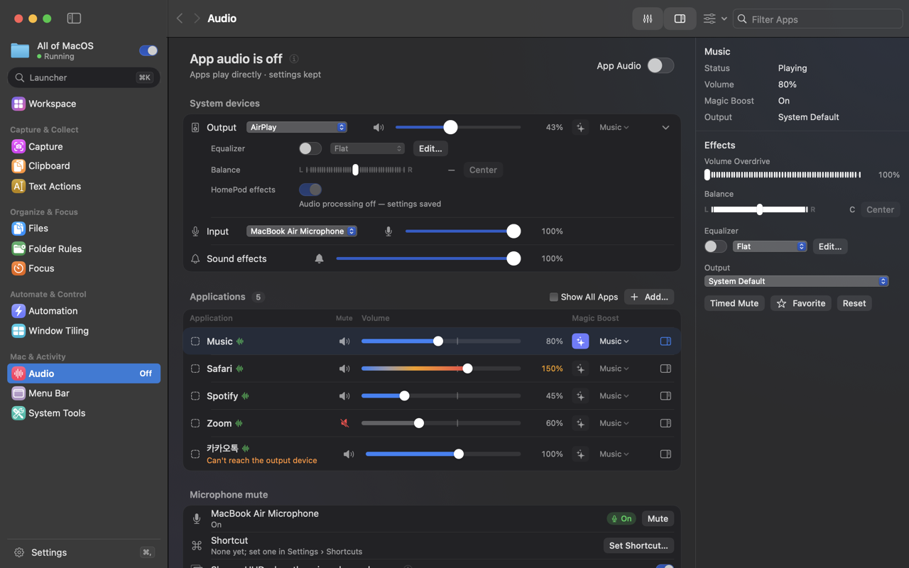 |

---

## 9. System Tools (`⌘7`) & Settings (`⌘,`)

- **System Tools (`⌘7`)**: Searchable maintenance & utility grid across 9 categories:
  - **Quick Toggles**: Dark Mode, Keep Awake, Hide Menu Bar, Dock Auto-Hide, Hidden Files, Desktop Icons, Wi-Fi, Bluetooth Device, Low Power Mode.
  - **Display & Power**: Display Resolution/Refresh Rate switcher, hardware DDC/CI Brightness, Battery Care (`80–100%` native charge limit, Hold Here, Discharge/Top Up), Sleep Timer, Awake While App Runs, Wake Assertions.
  - **Apps & Storage**: CPU/Memory Activity sheet, Kill Apps, Relaunch App, **App Uninstaller** (scans `~/Library` leftovers), Login Items, **Free Up Space** (Storage Map / Duplicates / Xcode junk / Caches), Eject Volumes, `.dmg` Installer.
  - **Network, Homebrew, Fix It & Tweaks**: Live Network Throughput 60s graph, Network Info, Apple `networkQuality` Speed Test, VPN / Tailscale controls, Flush DNS, Homebrew package/service manager, Restart Finder/Dock/Menu Bar, Repair Launch Services & Spotlight, and grouped Finder/Dock/Screenshot/Menu Bar Spacing tweaks.
- **Settings Hub (`⌘,`)**: Fast keyword-searchable settings across `General`, `Capture`, `Clipboard`, `Automation`, `AI`, `Shortcuts`, `Permissions`, `Data`, and `About`.

| System Tools | Settings Hub (`⌘,`) |
| :---: | :---: |
| 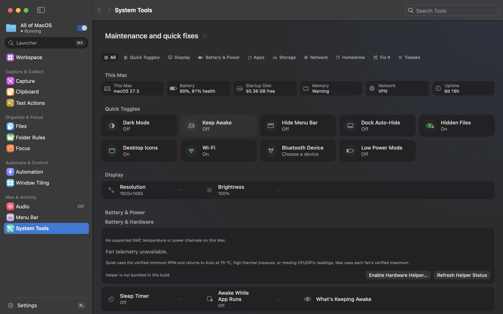 | 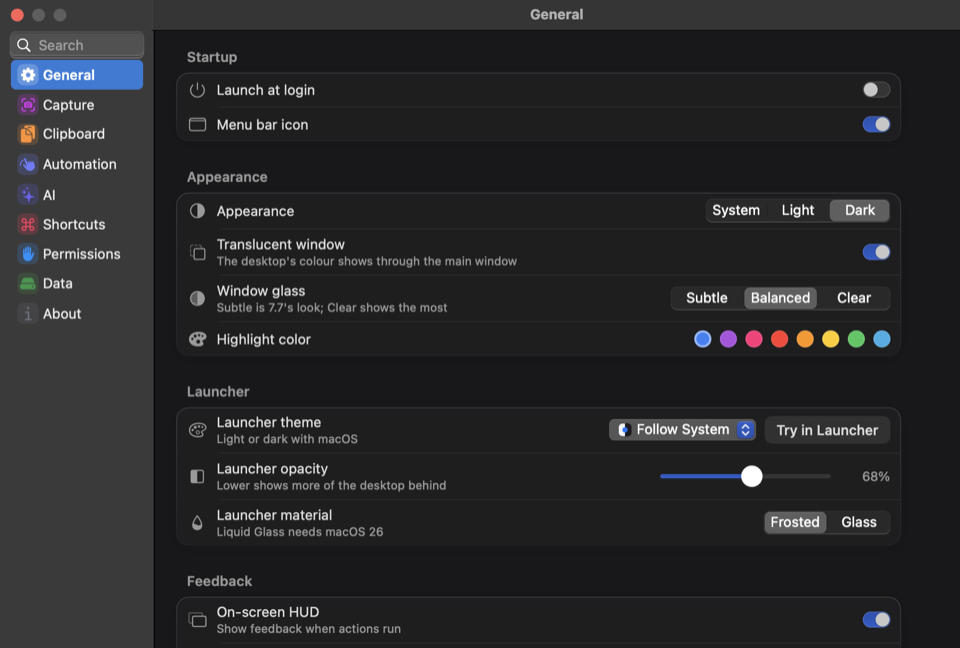 |

---

## 10. Usage Examples, MCP & URL Automation

### Launcher Search & Calculator (`⌥Space` or `⌘K`)
```text
12 * 11                                     -> 132
20% of 150                                  -> 30
10 km in mi                                 -> 6.21371 mi
255 in hex                                  -> 0xFF
in:~/Documents kind:pdf modified:7d invoice -> Filtered Spotlight search
:fire / arrow / won                         -> Emoji & Symbol insertion
```

### Clipboard Filter Operators (`⇧⌘V`)
```text
type:image from:Safari board:"Project Notes" is:pinned after:7d -draft
~deployment rollback checklist              -> Local semantic search
```
Supported filters: `type:text|link|image|file|color`, `from:<App>`, `board:<Name>` / `pinboard:<Name>`, `is:pinned` / `is:unpinned`, `before:` / `after:` / `on:` (`yyyy-MM-dd`, `today`, `yesterday`, `7d`, `2w`, `3m`, `1y`), `"exact phrase"`, `-exclude`.

### Ask AI Context Scopes (`⇥` in Launcher)
```text
@window summarize these error logs
@screen explain what is selected here
@files ~/Projects/notes find references to release signing
```
Available scopes: `@window`, `@screen`, `@clip`, `@wiki`, `@chats`, `@shell`, `@ssh`, and `@files` / `@~/path`.

### Dynamic Snippets & Folder Rules Tokens
- **Interactive Snippet Template**:
  ```text
  Hello {arg:recipient},

  Shipping method: {choice:Delivery|Courier|*Visit}
  Date: {date:yyyy-MM-dd}

  {optional:Signature}Best regards,
  {clipboard}{/optional}{cursor}
  ```
- **Folder Rules Tokens**: Subfolders `{year}-{month}` (`2026-11/Invoices`), rename `{name} {date:yyyy-MM-dd}`, `{pdfdate}`, `{after:Vendor}`.
- **Batch Rename Tokens**: `{date} {name} {nn}` with collision preview and inode-checked Undo.

### Title-Bar Trackpad Window Gestures
| Gesture (2 Fingers on Title Bar) | Action |
| --- | --- |
| Swipe `←` / `→` | Snap Left Half / Right Half (continue for Thirds) |
| Swipe `↑` | Maximize (`⇧` Almost Maximize; `↑` twice for Top Half) |
| Swipe `←↑` / `→↑` (L-shape) | Snap Top-Left / Top-Right Quarter |
| Swipe `↓` | Unsnap to prior frame / Minimize free window |
| Pinch In / Out | Close window (Pinch In twice to Quit) / Toggle Full Screen |
| Hold still `2 s` | Cancel gesture before lifting |

### URL Automation (`aom://`)
```bash
open "aom://capture-area"
open "aom://record-screen"
open "aom://show-keystrokes?mode=shortcuts"
open "aom://trigger?name=Tidy%20the%20front%20window"
```
External `aom://trigger` links always ask for explicit consent (`Run Once` / `Always Allow` / `Don't Run`).

### Local MCP Server (`AllOfMacOS --mcp`)
All of MacOS can expose a local stdio MCP server (`AllOfMacOS --mcp`) over an authenticated Unix-domain socket (`~/Library/Application Support/AllOfMacOS/mcp.sock`, mode `0600`, per-client SHA-256 tokens, never listening on the network):
- **Clipboard MCP**: `search`, `read_item`, `create_item`, `update_item`, `delete_item`, `copy_to_clipboard`, `list_pinboards`, `create_pinboard`, `rename_pinboard`, `delete_pinboard`, `add_item_to_pinboard`, `remove_item_from_pinboard`, `get_suggestions` (detected secrets are excluded from free-text search).
- **Automation & Audio MCP** *(per-client opt-in scope)*: `automation_catalog`, `automation_list_triggers`, `automation_save_named_trigger`, `automation_run_named_trigger`, `automation_list_menus`, `automation_save_menu`, `automation_show_menu`, `automation_hide_menus`, `automation_list_audio_apps`, `automation_set_app_volume`, `automation_set_app_mute`, `automation_route_app_audio`.

---

## Default Keyboard Shortcuts

| Feature | Shortcut | Feature | Shortcut |
| --- | --- | --- | --- |
| Global Launcher | `⌥Space` (`⌘K` in app) | Capture Area | `⇧⌘4` |
| Ask AI (in Launcher) | `⇥` | Capture Window | `⇧⌘5` |
| Quick Entry | `⌃⌥N` | Capture Full Screen | `⇧⌘3` |
| Clipboard History Shelf | `⇧⌘V` | Capture Text (OCR) | `⇧⌘2` |
| Paste Stack | `⇧⌘C` | Scrolling Capture | `⌥⇧⌘S` |
| Thumbnail Window Switcher | `⌃⇥` | Record Screen | `⌥⇧⌘R` |
| Screen Ruler (Measure) | `⇧⌘7` | Capture History | `⇧⌘6` |
| Click Hints | `⇧⌘Space` | Pin Last Capture | `⌥⇧⌘P` |
| Toggle Desktop Icons | `⌥⇧⌘D` | Page Navigation | `⌘1`–`⌘9` |

---

## Build, Test & Distribution

- **Requirements**: macOS 14+, Xcode / Swift toolchain, `webp` (`brew install webp` for packaging).
- **App Identifier**: `com.kyw.allofmacos` · **XPC Helper**: `com.kyw.allofmacos.ScriptRunner`
- **Build & Self-Sign**:
  ```bash
  brew list webp >/dev/null 2>&1 || brew install webp
  ALLOFMACOS_SCRATCH_PATH="$HOME/.cache/aom-build" ALLOFMACOS_SKIP_AUTO_RELEASE=1 ./build-and-sign.sh
  codesign --verify --deep --strict "build/All of MacOS.app"
  ```
- **Run Tests (SwiftPM)**:
  ```bash
  scripts/run-tests.sh -j "$(sysctl -n hw.ncpu)"
  ```
- **Distribution**: Prebuilt `.dmg` releases are published on [GitHub Releases](https://github.com/kyw1-2/All-of-MacOS/releases) signed with the self-signed **AOM Dev** certificate (not Apple Developer ID notarized; Gatekeeper may request manual approval on first launch). Detailed release notes live in [CHANGELOG.md](CHANGELOG.md).

---

## License

Released under the [MIT License](LICENSE). See [IDENTITY.md](IDENTITY.md) and [CHANGELOG.md](CHANGELOG.md) for bundle metadata and version history.
